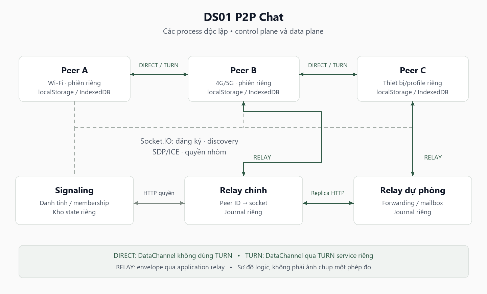

# Kiến trúc DS01 P2P Chat

Tài liệu dùng chung ngày 20/11/2026. Mô tả bản phát triển tích hợp; phạm vi phiên bản và kết quả ở [implementation-status.md](implementation-status.md).

## Thành phần và process

- Signaling: đăng ký, tài khoản/phiên, discovery, heartbeat, nhóm và trao đổi SDP/ICE.
- Application relay: ánh xạ Peer ID → socket, kiểm tra quyền/định dạng và chuyển envelope.
- Relay dự phòng: kết nối outbound khác, journal riêng và trao đổi replica qua mạng.
- Web peer: một phiên người dùng, PeerClient, transport, delivery và storage riêng.
- Web server: phục vụ giao diện. TURN là service riêng khi được cấu hình.

Có thể xem Node PID/bộ nhớ ở Task Manager → Details, các tab/renderer ở Chrome Task Manager bằng Shift+Esc, URL/PID/log ở dashboard demo. Web peer là một thực thể ứng dụng; trình duyệt quyết định cách phân bổ renderer. Không mặc định mỗi tab luôn tương ứng đúng một OS process.

## Luồng dữ liệu

Signaling hỗ trợ control plane, không chuyển chat body giữa peer. Socket.IO dùng HTTP long-polling/WebSocket và kết nối outbound. DataChannel là kênh WebRTC hai chiều.

1. A lookup B.
2. A/B trao đổi request/offer/answer/ICE qua signaling.
3. Khi DataChannel mở, kiểm tra selected ICE candidate pair.
4. Candidate không relay → DIRECT; có relay candidate → TURN.
5. Lỗi, đóng kênh hoặc timeout → application RELAY.
6. Receiver lưu rồi gửi ACK ứng dụng; sender cập nhật trạng thái.

Thiết lập DIRECT mặc định tối đa 10 giây; cửa sổ đọc route tối đa 1,5 giây. Không suy ra TURN chỉ vì cấu hình có turn: URL. STUN hỗ trợ thu thập candidate, không bảo đảm mọi NAT cho kết nối trực tiếp.

## Ranh giới lưu trữ

Node launcher của bản tích hợp mặc định dùng DS01-runtime/data ngoài repository; DS01_DATA_DIR cho phép chỉ định lại. Tài khoản/nhóm/khóa và mỗi relay journal có chủ sở hữu rõ ràng. Docker dùng named volume.

Web dùng localStorage cho hội thoại/receipt/contacts và IndexedDB cho file/khóa. Bản sao tài khoản được mã hóa trước khi gửi lên dịch vụ lưu trữ. Không dùng state file làm bus giữa peer hoặc relay; replica đi bằng HTTP có xác thực.

## Nhất quán và độ tin cậy

Membership dùng version/OCC tại một signaling writer. Tin có Message ID, session, sequence và logical time; retry cùng sự kiện, dedup và ACK theo receiver. Ordering giữ chuỗi sender/session rồi merge xác định, không đặt ra total order toàn hệ thống.

ACK mặc định 2 giây sau transport chấp nhận; một lượt gửi tối đa 3 lần. Failed là thiếu xác nhận, không chứng minh receiver chưa nhận. Mailbox nâng cao có queued riêng, hạn lưu và ACK cuối.

Nhiều relay hỗ trợ failover đường dữ liệu. Replication bất đồng bộ và election có lease có thể tạm khác khi mạng phân vùng; không phải consensus kiểu Raft. Signaling coordinator vẫn là một ranh giới khả dụng riêng.

## Topology demo

A trên laptop Wi-Fi, B trên điện thoại 4G/5G, C trên thiết bị hoặc browser profile riêng. Các client cùng dùng URL web/signaling/relay được cấu hình. Localhost luôn chỉ thiết bị đang mở browser.

Khi dùng tunnel, laptop đang chạy các process là host dịch vụ. Tunnel công khai URL; URL phiên dừng khi host hoặc tunnel dừng. Máy chủ thường trực dùng HTTPS/reverse proxy và storage bền vững theo deploy configuration.
