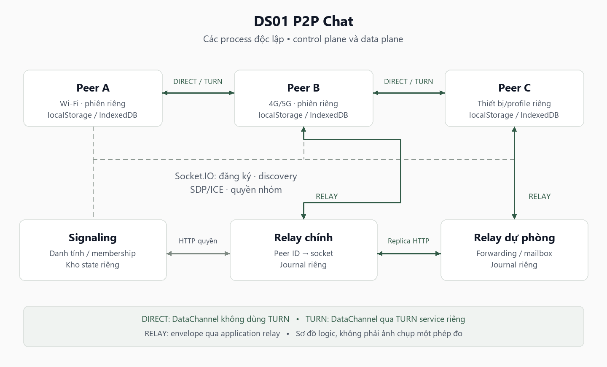

# DS01 P2P Chat

**BÁO CÁO BÀI TẬP LỚN — HỌC PHẦN HỆ THỐNG PHÂN TÁN**

Đề tài DS01: Xây dựng hệ thống chat P2P mô phỏng Skype.

Phiên bản tài liệu dùng chung ngày 20/11/2026.

| Thông tin                | Nội dung                                                             |
| ------------------------ | -------------------------------------------------------------------- |
| Cơ sở đào tạo, khoa, lớp | Nhóm điền trước khi nộp                                              |
| Giảng viên hướng dẫn     | Nhóm điền trước khi nộp                                              |
| Mã nhóm                  | Nhóm điền trước khi nộp                                              |
| Thành viên               | Nam, Hồng, Ngọc — bổ sung họ tên đầy đủ và MSSV                      |
| Repository               | https://github.com/Ngocnguyen055/DS01                                |
| Commit B2/B4 tham chiếu  | 8677e28 — Implement B2 WebRTC connectivity and B4 reliable messaging |

## 1. Thông tin nhóm và phân công

Báo cáo là sản phẩm chung của ba thành viên. Bảng dưới xác định trách nhiệm theo bảng phân công của nhóm; lịch sử commit và bằng chứng thực hiện được dùng để đối chiếu đóng góp.

| Thành viên | Nhiệm vụ         | Nội dung chính                                                                         |
| ---------- | ---------------- | -------------------------------------------------------------------------------------- |
| Hồng       | B1, B3, N8       | Signaling, discovery, xác thực; relay ứng dụng; thử tải và phân tích số liệu           |
| Nam        | B2, B4, D1       | WebRTC, STUN/TURN và chuyển đường; giao thức, ACK/retry/dedup/ordering; cấu hình CI/CD |
| Ngọc       | B5, B6           | Chat nhóm, nhất quán thành viên; web peer và lịch sử cục bộ                            |
| Cả nhóm    | Nghiệm thu chung | Tích hợp, ba peer, đồng thời, lỗi/phục hồi, báo cáo và thuyết trình                    |

Các đầu việc nâng cao có phần giao nhau giữa các thành phần. Nhóm chốt người thực hiện theo công việc thực tế; không coi toàn bộ một thư mục là đóng góp riêng của người đầu tiên push thư mục đó.

## 2. Tóm tắt

DS01 P2P Chat là nguyên mẫu chat phân tán gồm web peer, bootstrap/signaling và application relay độc lập. Mỗi peer vừa khởi tạo vừa tiếp nhận kết nối. Signaling hỗ trợ định danh, discovery và SDP/ICE; chat body đi qua WebRTC DataChannel hoặc application relay riêng.

Hệ thống ưu tiên WebRTC khi kết nối phù hợp. Nếu không thiết lập được, kết nối lỗi hoặc thiếu ACK ứng dụng, peer sử dụng relay qua kết nối Socket.IO outbound. Giao diện hiển thị DIRECT, TURN hoặc RELAY và mức xác nhận của tin.

Các cơ chế chính gồm Message ID/Session ID, sequence, logical time, ACK sau lưu trữ, retry hữu hạn, dedup, membership version và khôi phục sau restart. Phần mở rộng có nhiều relay, chọn relay, mailbox offline, replication, E2EE, DHT, truyền file và thoại/video ở mức nguyên mẫu.

Báo cáo mô tả bản phát triển tích hợp tại thư mục dự án và đối chiếu riêng B2/B4 trong commit 8677e28. Kết quả được ghi theo phiên bản nguồn và môi trường chạy. Khi chốt phiên bản nhóm, mã nguồn, dependency, cấu hình và tài liệu cần được hợp nhất cùng nhau.

## 3. Bài toán và yêu cầu

Hai thiết bị có thể nằm sau NAT, có IP riêng hoặc bị firewall giới hạn kết nối vào. Peer không thể chỉ lấy IP riêng của peer khác rồi mặc định mở kết nối thành công. Ngoài chọn đường truyền, ứng dụng cần phân biệt kết nối đã mở, gói đã chuyển và dữ liệu đã lưu ở người nhận.

| Mục trong đề | Nội dung triển khai                                               |
| ------------ | ----------------------------------------------------------------- |
| 4.1–4.2      | Process độc lập, danh tính node, giao tiếp mạng, log và giao thức |
| 4.3          | Tình huống đồng thời, OCC, version và mô hình nhất quán           |
| 4.4          | Timeout, bounded retry, ACK, lease, reconnect và failover         |
| 4.5          | Xác thực, phân quyền, validation, giới hạn dữ liệu, secret        |
| 5.1–5.5      | Discovery, WebRTC, NAT traversal, relay và chat hai chiều         |
| 5.6–5.9      | Nhóm, envelope, reliable delivery và relay routing                |
| 5.10         | Ba peer, log chứng minh tuyến, đồng thời và phục hồi              |
| 5.11         | Các chức năng mở rộng, được giải thích riêng                      |
| 9–11         | Test, hiệu năng, repository, báo cáo và trình diễn                |

Nguồn yêu cầu là COURSE PROJECT SPECIFICATION.pdf, trang 2–9 và 14–17. Các yêu cầu riêng DS02/DS03/DS04 không được tính thành yêu cầu bắt buộc của DS01.

## 4. Những vấn đề hệ thống phân tán

| Vấn đề       | Rủi ro                         | Cơ chế                                  |
| ------------ | ------------------------------ | --------------------------------------- |
| Định danh    | Hai phiên dùng cùng Peer ID    | Ràng buộc danh tính và phiên            |
| Discovery    | Trạng thái online cũ           | Heartbeat, lease, loại phiên hết hạn    |
| NAT/firewall | Không nhận kết nối vào         | ICE/STUN, TURN, application relay       |
| Giao tin     | Mất ACK, trùng bản nhận        | ID bất biến, ACK và dedup               |
| Ordering     | Đến muộn, đồng hồ vật lý lùi   | Sender/session sequence và logical time |
| Membership   | Hai sửa đổi ghi đè nhau        | Version và optimistic concurrency       |
| Khả dụng     | Relay dừng hoặc không phản hồi | Timeout, reconnect, relay dự phòng      |
| Persistence  | Process dừng khi ghi state     | Atomic snapshot và kiểm tra schema      |
| Replication  | Write/delete đến khác thứ tự   | Clock, origin, merge và tombstone       |

Các Map/biến trong process chỉ quản lý state nội bộ. Peer trao đổi qua mạng; không dùng shared file hoặc shared memory thay cho giao thức. Các relay có kho riêng và trao đổi replica bằng HTTP.

## 5. Phân tích và lựa chọn giải pháp

Nhóm dùng TypeScript, Node.js, React/Vite, Socket.IO và WebRTC. Socket.IO cung cấp kênh sự kiện với kết nối outbound; DataChannel cung cấp kênh peer hai chiều. Nhóm bổ sung logic giao tin, quyền truy cập, retry, ordering và phục hồi ở tầng ứng dụng.

So với chỉ có một chat server, thiết kế cho phép payload đi trực tiếp khi điều kiện phù hợp. So với chỉ dùng WebRTC, application relay cung cấp tuyến dự phòng qua endpoint truy cập được mà không yêu cầu mỗi user mở cổng.

| Mode   | Đường dữ liệu                            | Bằng chứng                                 |
| ------ | ---------------------------------------- | ------------------------------------------ |
| DIRECT | DataChannel, cặp ICE không dùng TURN     | Selected candidate pair và log peer        |
| TURN   | DataChannel qua candidate loại relay     | Selected candidate pair có relay candidate |
| RELAY  | Envelope qua Socket.IO application relay | relay:send và FORWARD cùng Message ID      |

STUN hỗ trợ lấy địa chỉ phản xạ và thử NAT traversal, không bảo đảm mọi NAT cho kết nối trực tiếp. TURN chuyển lưu lượng WebRTC; application relay chuyển envelope của ứng dụng. Chỉ cấu hình ICE server chưa đủ để kết luận đường được chọn là TURN.

Cơ sở giao thức được tham khảo từ RFC 8445, RFC 8489, RFC 8656, RFC 8831 và tài liệu Socket.IO.

## 6. Kiến trúc hệ thống



Signaling, từng relay và web server có process, cổng và lifecycle riêng. Browser tạo các peer với phiên và storage tách biệt. Những thành phần này có thể cùng host hoặc đặt trên các máy chủ khác nhau.

| Thành phần        | Trách nhiệm                                                       |
| ----------------- | ----------------------------------------------------------------- |
| Signaling         | Tài khoản/phiên, discovery, lease, SDP/ICE, nhóm và key directory |
| Application relay | Peer ID → socket, validation, forwarding, mailbox                 |
| Relay dự phòng    | Tuyến dự phòng, journal replica và discovery overlay              |
| Web peer          | Chọn đường, gửi/nhận, ACK/retry, lịch sử và hiển thị              |
| Web server        | Phục vụ giao diện tĩnh hoặc dev server                            |
| TURN              | Allocation và chuyển tiếp lưu lượng WebRTC                        |

Signaling/relay dùng Socket.IO qua HTTP long-polling hoặc WebSocket; endpoint công khai dùng HTTPS/WSS khi có TLS. DataChannel dùng ngăn xếp WebRTC, không phải một HTTP request cho từng tin.

Signaling không chuyển chat body giữa hai peer. API kiểm tra quyền chỉ dùng thông tin cần cho quyền truy cập. Kho đồng bộ tài khoản nhận bản sao đã mã hóa; chức năng lưu đó tách biệt với đường giao tin.

## 7. Thiết kế thành phần và giao thức

PeerClient phối hợp DirectTransport, MessageDelivery, FileTransfer và ChatStore. DirectTransport quản lý kết nối; MessageDelivery quản lý sự kiện/ACK; ChatStore là ranh giới persistence.

Ví dụ một envelope:

```json
{
  "messageId": "f5515419-f620-4823-a416-560033e3e0bf",
  "sessionId": "9110ba98-e1b4-4936-9a9b-1cb2daa63dc9",
  "senderId": "peer-a",
  "receiverId": "peer-b",
  "groupId": null,
  "type": "text",
  "timestamp": 1795180000000,
  "logicalTime": 1795180000001,
  "body": "Xin chào",
  "mode": "DIRECT",
  "ackRequested": true,
  "attempt": 1,
  "sequence": 1
}
```

Message ID nhận diện một sự kiện. Session ID và sequence xác định chuỗi hội thoại. Retry giữ ID, nội dung và ordering metadata; mode/attempt được phép đổi. Fan-out nhóm tạo envelope riêng từng receiver, cùng sự kiện logic.

ACK có Message ID riêng, ackFor trỏ tới tin gốc và ackRequested=false. Receiver ACK sau khi chấp nhận lưu; sender kiểm tra ackFor, session, sender/receiver, group và sequence. RPC ACK của relay không thay ACK ứng dụng.

Text giới hạn 4000 ký tự; plaintext envelope tối đa 8192 byte UTF-8 sau chuẩn hóa. File cá nhân tối đa 512 KiB; attachment envelope tối đa ba metadata. E2EE dùng envelope ngoài giới hạn 16384 byte và giữ các trường cần cho routing.

## 8. Định danh và khám phá peer

Luồng tài khoản dùng Peer ID ổn định user_<username>. Luồng thử nghiệm kỹ thuật dùng Peer ID/proof riêng. Luồng DHT nâng cao tạo định danh gắn với khóa ký.

Bản tích hợp đăng ký Peer ID, display name, status và connectivity metadata. Signaling kiểm tra proof, phiên và xung đột ID trước khi cấp token relay. List/lookup không trả token hoặc socket nội bộ của peer khác.

Heartbeat mặc định 10 giây; lease mặc định 30 giây và có vòng quét. Disconnect, hết hạn hoặc thu hồi phiên làm cập nhật registry online và presence. Connection mapping được tái tạo khi kết nối lại; registry danh tính được giữ bền vững.

Ở thiết bị mới, dữ liệu phụ thuộc hai lớp: storage tại browser và bản sao tài khoản đã mã hóa. Luồng chuyển thiết bị xác nhận tiếp quản phiên, khôi phục kho mã hóa và giữ Peer ID. Những dữ liệu chỉ còn ở thiết bị cũ không tự xuất hiện nếu chưa có bản sao phù hợp.

## 9. Đồng thời, đồng bộ và nhất quán

Hai peer gửi gần đồng thời được quản lý bằng Message ID độc lập và pending ACK theo message/receiver. Tin dữ liệu nhận được tuần tự hóa ở ranh giới lưu; ACK xử lý riêng để một thao tác lưu chậm không chặn xác nhận của lần gửi khác.

Hai sửa đổi nhóm cùng version được xử lý bằng OCC. Signaling kiểm tra quyền/version, lưu một kết quả hợp lệ, tăng version và phát update. Request stale bị từ chối; client lấy state mới để thực hiện thao tác tiếp theo.

Journal của relay dùng logical clock, origin và tombstone. Merge xác định giúp replica hội tụ khi nhận write/delete theo thứ tự khác nhau.

| State            | Mô hình                                             |
| ---------------- | --------------------------------------------------- |
| Membership       | Kiểm soát version tại một signaling writer          |
| Thứ tự hội thoại | Sequence trong chuỗi sender/session, merge xác định |
| Bản nhận         | Dedup sender/Message ID, kiểm tra nội dung bất biến |
| Replica journal  | Eventual convergence sau trao đổi                   |

Không đặt ra total order toàn hệ thống. Các bất biến được kiểm tra: không nhận trùng trong phạm vi dedup; stale version không ghi đè state mới; fan-out giữ cùng danh tính sự kiện; người nhận đã ACK không bị gửi lại chỉ vì người khác lỗi.

## 10. Chịu lỗi và phục hồi

Failure model gồm crash/restart, mất kết nối, RPC không phản hồi, mất ACK, trùng và đảo thứ tự. Timeout/lease xác định cách xử lý; một peer chậm có thể tạm bị coi là không khả dụng.

| Cơ chế                 | Mặc định                               |
| ---------------------- | -------------------------------------- |
| Thiết lập DataChannel  | Tối đa 10 giây, có thể cấu hình        |
| Đọc selected ICE route | Cửa sổ tối đa 1,5 giây khi kênh mở     |
| RPC signaling/relay    | Timeout 4 giây                         |
| ACK ứng dụng           | 2 giây sau khi transport chấp nhận gửi |
| Retry                  | Tối đa 3 lần truyền trong một lượt     |
| Heartbeat/lease        | 10 giây / 30 giây, cộng chu kỳ quét    |
| Mailbox nâng cao       | Hạn lưu mặc định 24 giờ                |

Kênh DIRECT đang mở bị đóng/lỗi làm DirectTransport phát mode RELAY. Retry dùng cùng ID; receiver chống trùng nếu bản trước đã lưu nhưng ACK bị mất.

Đóng peer hủy promise chờ. Pending/sent/forwarded của phiên gián đoạn được phục hồi thành chưa xác nhận thay vì báo đã giao. Nếu relay không trả RPC, peer thử tuyến khác; hết tuyến/ngân sách thì báo failed.

Queued chỉ có nghĩa relay đã lưu. ACK người nhận mới xác nhận delivered. Replica bất đồng bộ có cửa sổ giữa ghi local và lan truyền; hai relay cùng host vẫn thuộc một failure domain.

## 11. Bảo mật

Mật khẩu được băm bằng scrypt với salt riêng; server không lưu mật khẩu plaintext. Token có thời hạn, lưu hash tại server và có thể thu hồi. Relay kiểm tra token, subject và phiên trước request.

Sender binding, membership và block policy được kiểm tra ở các ranh giới phù hợp. Schema kiểm tra ID, type, nội dung, thời gian, ordering metadata, SDP/ICE và kích thước. Rate limit hạn chế lạm dụng; callback sai được chặn để không làm process thoát.

Secret dịch vụ lấy từ môi trường hoặc kho secret riêng. Repository dùng placeholder. VITE_* là cấu hình có thể xuất hiện trong bundle browser, không phải kho cất khóa ký server.

Khi bật E2EE, peer dùng ECDH P-256, HKDF và AES-GCM; pin danh tính và luồng thay khóa kiểm soát thay đổi identity. Envelope ngoài vẫn lộ metadata định tuyến. Replica RPC dùng HMAC, timestamp và nonce; URL thành viên được giới hạn.

HTTPS/TLS bảo vệ kết nối tới dịch vụ; E2EE bảo vệ nội dung khỏi relay. Hai cơ chế giải quyết những ranh giới khác nhau. An toàn vẫn phụ thuộc thiết bị, khóa và mã giao diện mà người dùng chạy.

## 12. Các chức năng nâng cao

Bảng này mô tả phần mở rộng của bản tích hợp:

| Chức năng              | Cách thực hiện                                   |
| ---------------------- | ------------------------------------------------ |
| Nhiều relay            | Pool kết nối outbound                            |
| Chọn theo latency/load | RTT làm mượt, số peer và pending mail            |
| Tự chuyển relay        | Timeout/disconnect và thử tuyến dự phòng         |
| Bầu super-peer         | Ứng cử relay đồng hành, endpoint, lease và merge |
| Replication            | Journal qua HTTP giữa các kho riêng              |
| Store-and-forward      | Mailbox có TTL; queued khác delivered            |
| E2EE                   | Khóa đầu cuối, ciphertext và xác thực metadata   |
| DHT                    | Hash ring, signed record có thời hạn             |
| File transfer          | Chunk 2304 byte, ACK, SHA-256, IndexedDB         |
| STUN                   | Binding và thu thập candidate trong ICE          |
| WebRTC/TURN            | DataChannel qua selected relay candidate         |
| Thoại/video            | Nhận cuộc gọi, quyền thiết bị, mute, hangup      |
| Load test              | Simulated peers và giới hạn concurrency          |

DHT/election là nguyên mẫu trên tập relay cấu hình, không phải Kademlia/Raft hoàn chỉnh. Replication mailbox không sao chép toàn bộ tài khoản/nhóm của signaling. Resume file dang dở qua restart là hướng mở rộng.

## 13. Cài đặt và tổ chức mã

Node theo package là ^20.19.0 hoặc từ 22.12.0. Bộ kết quả hiện ghi nhận Windows/Node v25.2.1. Browser cần WebRTC, Web Crypto và IndexedDB.

```powershell
npm.cmd ci
npm.cmd run setup:env
```

Mở ba terminal, mỗi terminal chạy một process:

```powershell
npm.cmd run dev:signaling
npm.cmd run dev:relay
npm.cmd run dev:web
```

Signaling mặc định 4001, relay 4002, web dev 5173. Localhost trỏ về chính thiết bị mở browser. Bản tích hợp có demo:local/demo:public và dashboard PID/URL/log.

Kho bền vững khi chạy Node mặc định là DS01-runtime/data ngoài source; DS01_DATA_DIR cho phép cấu hình lại. Docker sử dụng volume theo deploy configuration.

| Thư mục                  | Trách nhiệm                                        |
| ------------------------ | -------------------------------------------------- |
| src/shared               | Protocol, transport, delivery, ordering, peer core |
| src/signaling            | Auth, discovery, nhóm và SDP/ICE                   |
| src/relay                | Routing và mở rộng relay                           |
| src/server-kit           | Runtime, log, secret và storage                    |
| src/web-peer             | Giao diện, lịch sử, khóa và account sync           |
| deploy / scripts / tests | Triển khai, công cụ và kiểm thử                    |
| docs                     | Tài liệu dùng chung                                |

## 14. Kiểm thử và kết quả

Đợt evaluate ngày 20/11/2026 kết thúc lúc 23:26 giờ Việt Nam: 247/247 test đạt trên working tree tích hợp. Ma trận chọn của mục 9 có 8 functional, 3 concurrency/conflict, 3 fault/recovery và 3 security/invalid-data đạt. Hiệu năng được đo bằng thí nghiệm riêng.

| Nhóm           | Ví dụ                                                                     |
| -------------- | ------------------------------------------------------------------------- |
| Functional     | Registration, metadata, hai chiều, dedup, ordering, nhóm/file mã hóa, DHT |
| Concurrency    | Trùng ID khi đăng ký; merge write/delete; hai sự kiện dùng cùng ID        |
| Fault/recovery | Relay không trả RPC; signaling restart; offline mail qua relay khác       |
| Security       | Đổi metadata/ciphertext; replay replica request; record giả/hết hạn       |

Các lần browser ngày 20/11 ghi nhận 54 kiểm tra cơ bản, 19 advanced và 16 account recovery đạt. Phạm vi là Chrome thật, DataChannel/IndexedDB và service trên loopback. Bộ advanced chạy STUN/TURN lab và media thật; account recovery dùng browser context/origin khác nhau.

Baseline Nam 8677e28 có 78 test B2/B4 đạt; toàn bộ baseline có 118/120 test đạt. Hai test công cụ đo tải/benchmark cho cùng lỗi trên baseline main 60867fe. Các sửa đổi công cụ thuộc phần tích hợp và cần đi cùng bản phát hành chung.

Các con số mô tả các snapshot khác nhau, không thay thế nhau. Hồ sơ tổng hợp ở evidence/validation-2026-11-20.json giữ mốc chạy, commit/fingerprint có sẵn và phạm vi. Bảng manual-results.csv dành cho kết quả mỗi buổi nghiệm thu.

## 15. Đánh giá hiệu năng

Thử tải ngày 20/11 trên localhost dùng simulated Socket.IO peers, kiểm tra đúng socket nhận và nguyên envelope. Latency đo đến sự kiện nhận, không bao gồm browser persistence/ACK ứng dụng.

| Peers | Messages | Workers | Delivered | Throughput (message/s) | p50 (ms) | p95 (ms) |
| ----- | -------- | ------- | --------- | ---------------------- | -------- | -------- |
| 3     | 60       | 1       | 60        | 395,39                 | 2,15     | 3,84     |
| 20    | 200      | 8       | 200       | 453,30                 | 15,85    | 31,31    |
| 50    | 500      | 20      | 500       | 755,24                 | 24,68    | 43,97    |
| 100   | 1000     | 50      | 1000      | 772,30                 | 58,25    | 115,13   |

Mỗi kịch bản có 0 duplicate, 0 misrouted, 0 corrupted delivery. Đây là điểm đo, không phải giới hạn công suất tối đa.

Thí nghiệm Chrome riêng đo từ lưu pending đến lưu delivered, gồm kiểm tra quyền và ACK ứng dụng. Mỗi mode có 20 mẫu sau một warmup, body 256 byte:

| Mode   | p50 (ms) | p95 (ms) | Max (ms) |
| ------ | -------- | -------- | -------- |
| DIRECT | 99,50    | 144,50   | 144,70   |
| RELAY  | 127,70   | 159,60   | 167,20   |

Median RELAY cao hơn DIRECT khoảng 28,20 ms trong bộ mẫu này. Scheduling, persistence và quyền truy cập cũng ảnh hưởng, nên không quy toàn bộ chênh lệch cho một bước mạng.

Payload relay hai chiều xấp xỉ 2 × message rate × envelope bytes, chưa tính framing, ACK, mã hóa và replication. Relay cùng host chia sẻ CPU/uplink; tăng số relay không tự động tăng tài nguyên host.

## 16. Kịch bản trình diễn

Ba peer A/B/C dùng tài khoản và browser profile tách biệt. Laptop Wi-Fi và điện thoại 4G/5G tạo hai miền mạng; peer thứ ba dùng thiết bị hoặc context riêng.

| # theo 5.10 | Thao tác                               | Dấu hiệu quan sát                      |
| ----------- | -------------------------------------- | -------------------------------------- |
| 1           | Mở URL dịch vụ và web                  | Health, dashboard, process phục vụ     |
| 2           | Khởi động A/B/C                        | Ba danh tính riêng                     |
| 3           | Đăng nhập/discovery                    | REGISTER và presence                   |
| 4           | Chat trên DataChannel                  | DIRECT và ACK                          |
| 5           | Đối chiếu Message ID                   | DIRECT ở peer, không FORWARD tại relay |
| 6           | Dùng cặp có đường trực tiếp bị hạn chế | Tin tự đi RELAY                        |
| 7           | Đối chiếu log                          | SEND/RECEIVE/FORWARD cùng ID           |
| 8           | Tạo nhóm A/B/C                         | Membership/version và fan-out          |
| 9           | B/C gửi gần đồng thời                  | Không trùng, ACK từng receiver         |
| 10          | Dừng đột ngột C                        | Presence đổi theo disconnect/lease     |
| 11          | Đóng DIRECT đang mở                    | Fallback tự động                       |
| 12          | Mở lại C                               | Giữ danh tính/lịch sử và nhận tin mới  |

Dùng Task Manager/Details để xem Node PID và bộ nhớ, Chrome Task Manager để xem renderer, dashboard để xem URL/log. Không suy ra chia sẻ bộ nhớ từ số virtual memory.

Checkbox ép relay phục vụ kiểm tra chủ đích; selected candidate và log giải thích đường thực tế. Kịch bản chi tiết ở demo-script.md và MANUAL-ACCEPTANCE.md.

## 17. Triển khai và CI/CD

Web được phục vụ qua HTTPS; reverse proxy chuyển signaling/relay đến các process riêng. TURN có endpoint/allocation riêng. Nếu laptop chạy tunnel, laptop là host dịch vụ; tunnel công khai URL và chuyển tiếp về đó. Dừng host/tunnel làm URL phiên dừng.

Triển khai giữ registry, khóa, vault và journal trên storage bền vững. Không xóa volume để thử restart; không cho hai signaling writer cùng ghi một state file.

Thiết kế CI/CD của bản phát triển gồm verify dependency/type/lint/test/build; browser regression; build app/web container; publish image gắn commit SHA; manual deployment qua SSH host identity đã pin và health check.

Rollback image dùng release trước; dữ liệu/migration cần backup riêng. Kết quả pipeline được ghi bằng Actions run/artifact tương ứng, không suy ra từ việc có file YAML.

Với B2/B4 và tài liệu chung, nhóm push Nam rồi review Pull Request Nam → main. Workflow CI/CD được hợp nhất cùng phần D1 và các dependency liên quan.

## 18. Giới hạn và hướng phát triển

Tài khoản/membership có một signaling coordinator. Nhiều relay bảo vệ đường dữ liệu trong phạm vi lỗi relay, không tự cung cấp failover cho mọi state. Replica bất đồng bộ có thể tạm khác và có cửa sổ mất ghi trước lan truyền.

Delivery là best effort với retry hữu hạn, ACK và dedup có retention. Failed nghĩa thiếu xác nhận trong ngân sách, không chứng minh receiver chưa từng lưu. Không có cam kết exactly-once tuyệt đối hoặc total order toàn hệ thống.

Mailbox có TTL/quota; file 512 KiB; browser storage phụ thuộc quota/vòng đời dữ liệu. Thiết bị mới cần bản sao mã hóa và thông tin mở khóa. DHT/election cần làm mới lease.

Hướng mở rộng: relay ở nhiều failure domain, đo trên nhiều cấu hình mạng, telemetry/quota vận hành, resume file, key recovery và giảm phụ thuộc signaling coordinator.

## 19. Kết luận

DS01 P2P Chat tổ chức peer và dịch vụ độc lập giao tiếp qua mạng, ưu tiên WebRTC và có application relay. Message ID, ACK, retry, dedup, sequence và version giải quyết độ tin cậy/đồng thời ở tầng ứng dụng.

Báo cáo phân biệt baseline đã commit, bản tích hợp và từng phép đo để người đọc đối chiếu đúng. Nhóm hoàn thiện thông tin học vụ, hợp nhất mã và điền biên bản demo trước khi chốt report.pdf cùng tag/release.

## 20. Tài liệu tham khảo

- [1] COURSE PROJECT SPECIFICATION.pdf, tài liệu giảng viên cung cấp, 17 trang; mục 4, 5, 9, 10, 11, 13.
- [2] [Mã nguồn DS01](https://github.com/Ngocnguyen055/DS01).
- [3] IETF, [RFC 8445 — ICE](https://www.rfc-editor.org/rfc/rfc8445).
- [4] IETF, [RFC 8489 — STUN](https://www.rfc-editor.org/rfc/rfc8489).
- [5] IETF, [RFC 8656 — TURN](https://www.rfc-editor.org/rfc/rfc8656).
- [6] IETF, [RFC 8831 — WebRTC Data Channels](https://www.rfc-editor.org/rfc/rfc8831).
- [7] Socket.IO, [Delivery guarantees](https://socket.io/docs/v4/delivery-guarantees/).
- [8] Node.js, [Crypto — scrypt](https://nodejs.org/api/crypto.html#cryptoscryptpassword-salt-keylen-options-callback).

Nhóm kiểm tra, hiểu và chịu trách nhiệm về thư viện, mã nguồn, công cụ hỗ trợ và kết quả theo mục 13 của đề bài.

## 21. Phụ lục

| Tệp                                                | Mục đích                              |
| -------------------------------------------------- | ------------------------------------- |
| report.md / report.docx / report.html / report.pdf | Nội dung gốc, Word, xem web và bản in |
| architecture.md / protocol.md                      | Thiết kế thành phần và envelope       |
| authentication.md / advanced-features.md           | Tài khoản và phần mở rộng             |
| test-plan.md / implementation-status.md            | Ma trận, phiên bản và kết quả         |
| demo-script.md / MANUAL-ACCEPTANCE.md              | Kịch bản và bước nghiệm thu           |
| manual-results.csv                                 | Biên bản từng buổi                    |
| evidence/validation-2026-11-20.json                | Số liệu tổng hợp có nguồn và phạm vi  |

Ảnh/JSON của đợt cũ trong evidence giữ giá trị lịch sử của chính lần chạy đó; không thay ngày hoặc kết quả để coi thành bằng chứng của phiên bản khác.
